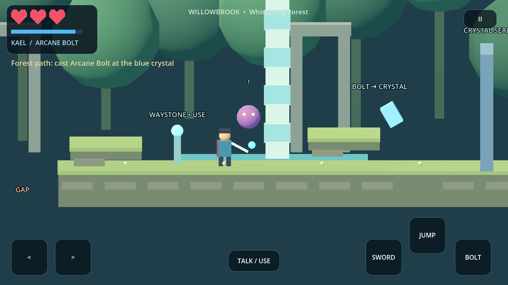
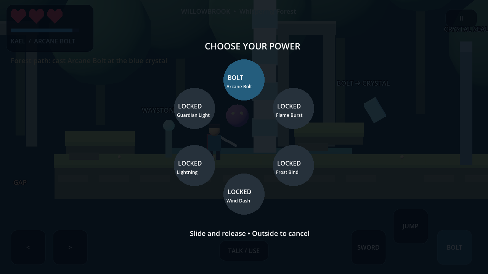

# Shadowblade: The Last Guardian

A Godot 4.6.3 / GDScript prototype of **Willowbrook**, the first region of an original offline, landscape action adventure. Kael moves along a fixed side-scrolling plane inside a real 3D scene.

This is an initial playable foundation, not a finished visual slice or the complete six-region game. All models, effects and sounds are temporary originals. The reference image mentioned in the brief was not included; matching that image has not been verified.

## Play

Install the standard **Godot 4.6.3** editor (no .NET edition or external packages required). Import `project.godot` and press **F6** on `scenes/main.tscn`, or **F5** to run the project.

```bash
godot --editor --path .
godot --path .
```

In the managed cloud sandbox, use `./tools/godot.sh` in place of `godot --path .`. It redirects Godot's data/config/cache directories to writable workspace folders. A graphical display is required to play visually; headless checks work without one.

| Action | Keyboard | Phone / mouse |
| --- | --- | --- |
| Move | A/D or arrows | Separate left/right controls |
| Jump | Hold Space; release for a lower jump | Hold Jump |
| Sword combo | J or X; repeat to chain | Sword |
| Arcane Bolt | Tap K or C | Tap Bolt; casts on release |
| Power wheel | Hold K or C; release selects Bolt | Hold Bolt, slide, release; outside cancels |
| Talk / rest / use | E | Talk / Use |
| Pause | Escape | Top-right pause |
| Journal | Tab or pause menu | Pause → Quest journal |

Talk to **Lyra** near the spawn to receive the quest. Head east, jump the forest gap, attune the glowing waystone, jump onto the crystal ledge, and shoot the blue crystal. Pass the seal, rest at the second waystone, then defeat the Hollow Warden. Jump during its amber shockwave and attack during recovery. Continue east to finish the prototype, or return to the village. Explore the upper ledges for Orin's sun shard.

## Implemented

- Three red hearts, half-heart damage, brief damage immunity, shared blue magic bar, configurable movement/combat values, delayed magic regeneration.
- Acceleration, coyote time, buffered and variable-height jumps; simple procedural walking and sword animations.
- Independent finger ownership, slide-off cleanup, pause/focus-loss input reset, six-slot hold wheel with five locked powers.
- Three village NPCs, guide dialogue, main quest, optional shard quest, merchant restoration, village rest and two route checkpoints.
- Continuous village/forest route, upper secret path, waterfall and ruins, bolt-operated crystal seal.
- Telegraph/recovery combat with melee creatures, hovering ranged wisps and a mini-boss; solid surfaces block sword and bolt hits.
- Death resets encounters at the saved checkpoint and preserves unlocks, inventory and quest progress. Pits cost half a heart and return to recent safe ground.
- Title, continue/new-game confirmation, pause, journal, travel back to the discovered village, sound/shake/control-size/quality/frame-limit settings.
- One validated local JSON slot; write to a temporary file, retain a valid backup, and replace the primary save. Recover from the backup if the primary is invalid. Save errors are displayed.
- Original generated geometry and simple synthesized combat sounds. No accounts, network calls or paid services.

Progress lives in Godot's `user://journey.json`; the previous valid save is `journey.json.bak`. In this cloud machine these are under `/workspace/.local/share/godot/app_userdata/Shadowblade- The Last Guardian/`. Tests use separate slots and do not touch the player's save. Restarting loads the saved checkpoint, not an unfinished combat state.

## Actual gameplay captures

These are engine-rendered screenshots of this prototype using Mesa llvmpipe on Linux. They are **not concept art** or images of the absent reference sample. The capture script stages positions in the real scene.





## Validate

```bash
./tools/check.sh
```

Runs the real Godot scene with physics and synthetic input at fixed simulation timing. It exits on any failing suite:

- `tests/gameplay.tscn`: 37 combat, input, movement, save and lifecycle regression checks.
- `tests/journey.tscn`: 15 checks covering travel from Lyra to the boss, completion and scene reconstruction from saved data, without forced respawns.
- `tests/exploration.tscn`: 4 checks for the optional platform route, shard and merchant reward.

See [validation evidence and limits](docs/validation.md). Fixed simulation timing is a correctness aid, not a performance benchmark. To regenerate captures with a working graphical display:

```bash
./tools/godot.sh --rendering-method gl_compatibility --audio-driver Dummy res://tests/capture.tscn
```

## Remaining work

- Replace primitive art and synthesized tones with finished original/licensed models, animations, UI, lighting, music and ambience. The current readable blockout does not match a polished concept image.
- Tune combat, camera, platforming and mobile ergonomics through human playtesting. NPCs are stationary; the merchant offers a quest reward, not a full shop/economy.
- Test physical multitouch, cutouts, interruption/resume and save persistence on named Android phones; profile memory, frame times and battery use. Neither stable 60 FPS nor Android compatibility has been measured.
- Android SDK/export templates/signing and an APK: see [Android instructions](docs/android.md). No device, emulator or SDK is available in the current cloud instance.
- Five remaining villages/powers, their dungeons and bosses, final fortress, and Lord Vaelor. No locked ability is falsely presented as playable. Travel currently returns to the only discovered village.
- Broader scene transitions, localization, accessibility review and production save migrations.

The source briefs are retained in [design-brief.md](docs/design-brief.md) and [design-notes.md](docs/design-notes.md). Finish the Willowbrook visual and device validation milestone before expanding to the next region.
