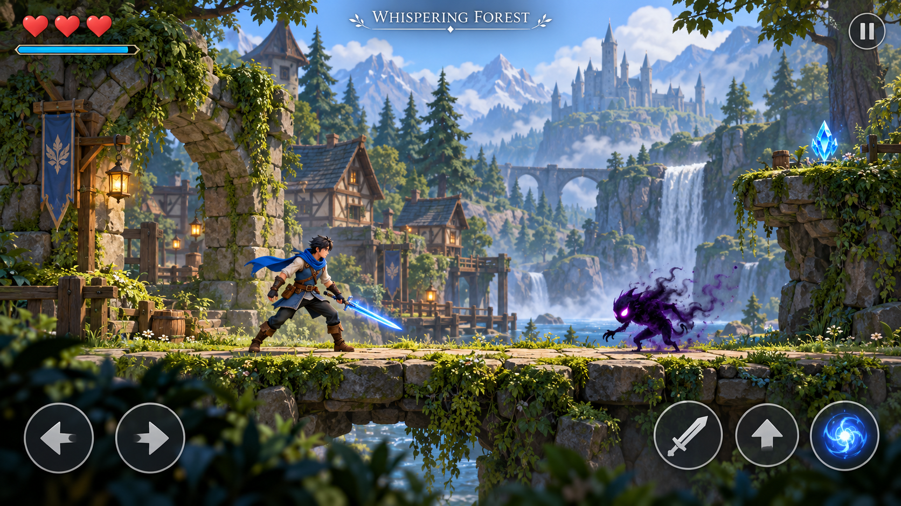
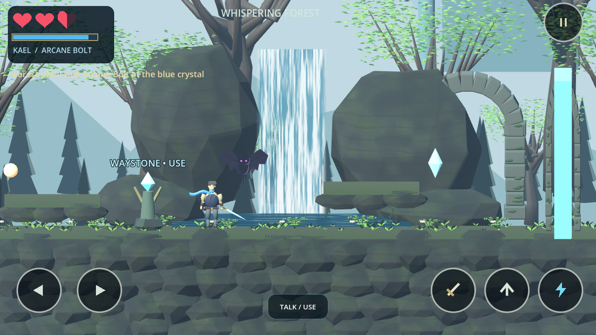
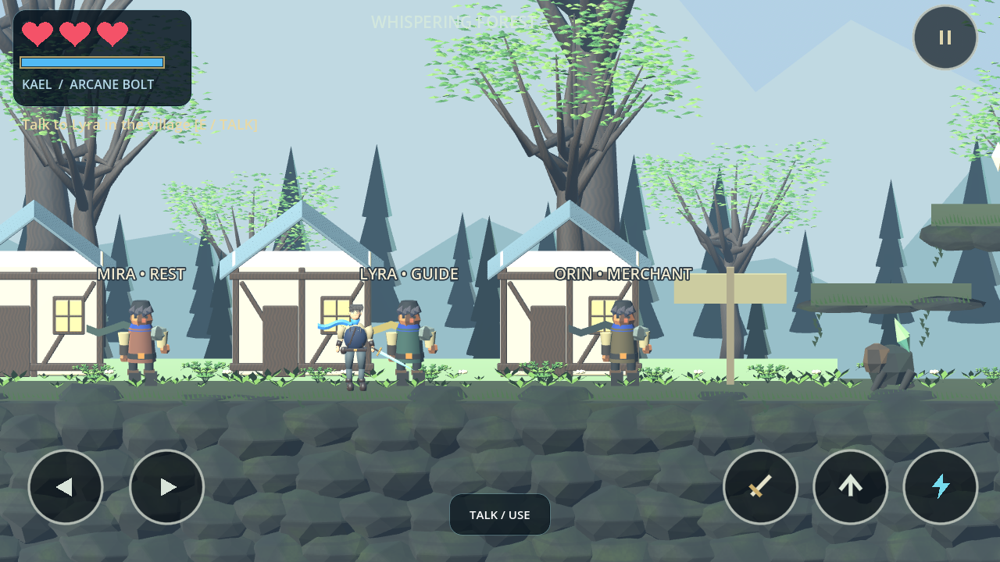
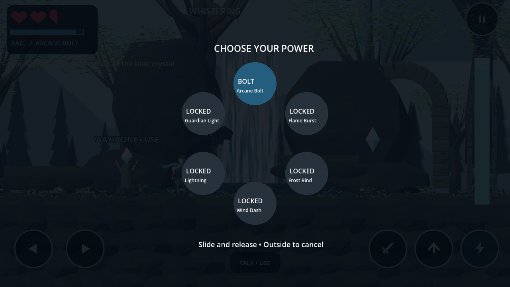

# Shadowblade: The Last Guardian

A Godot 4.6.3 / GDScript prototype of **Willowbrook**, the first region of an original offline, landscape action adventure. Kael moves along a fixed side-scrolling plane inside a real 3D scene.

**Visual approval is pending.** This milestone replaces the representative forest's primitive art with Blender-authored assets. It preserves existing gameplay and focuses on one forest section, not expansion of villages. It does **not** establish parity with the approved concept.

[Side-by-side visual review](docs/visual-review.html) · [Changes and remaining gaps](docs/forest-revision.md) · [Blender asset credits](docs/ATTRIBUTION.md)

| Approved concept (not gameplay) | Current engine gameplay capture |
| --- | --- |
|  |  |

## Play

Install the standard **Godot 4.6.3** editor (no .NET edition or external packages required). Import `project.godot` and press **F6** on `scenes/main.tscn`, or **F5** to run the project.

```bash
godot --editor --path .
godot --path .
```

In the managed cloud sandbox, use `./tools/godot.sh` in place of `godot --path .`. It redirects Godot's data/config/cache directories to writable workspace folders. A graphical display is required to play visually; headless checks work without one.

| Action | Keyboard | Phone / mouse |
| --- | --- | --- |
| Move | A/D or arrows | Separate left/right controls |
| Jump | Hold Space; release for a lower jump | Hold Jump |
| Sword combo | J or X; repeat to chain | Sword |
| Arcane Bolt | Tap K or C | Tap Bolt; casts on release |
| Power wheel | Hold K or C; release selects Bolt | Hold Bolt, slide, release; outside cancels |
| Talk / rest / use | E | Talk / Use |
| Pause | Escape | Top-right pause |
| Journal | Tab or pause menu | Pause → Quest journal |

Talk to **Lyra** near the spawn to receive the quest. Head east, jump the forest gap, attune the glowing waystone, jump onto the crystal ledge, and shoot the blue crystal. Pass the seal, rest at the second waystone, then defeat the Hollow Warden. Jump during its amber shockwave and attack during recovery. Continue east to finish the prototype, or return to the village. Explore the upper ledges for Orin's sun shard.

## Implemented

- Three red hearts, half-heart damage, brief damage immunity, shared blue magic bar, configurable movement/combat values, delayed magic regeneration.
- Acceleration, coyote time, buffered and variable-height jumps; simple procedural walking and sword animations.
- Independent finger ownership, slide-off cleanup, pause/focus-loss input reset, six-slot hold wheel with five locked powers.
- Three village NPCs, guide dialogue, main quest, optional shard quest, merchant restoration, village rest and two route checkpoints.
- Continuous village/forest route, upper secret path, waterfall and ruins, bolt-operated crystal seal.
- Telegraph/recovery combat with melee creatures, hovering ranged wisps and a mini-boss; solid surfaces block sword and bolt hits.
- Death resets encounters at the saved checkpoint and preserves unlocks, inventory and quest progress. Pits cost half a heart and return to recent safe ground.
- Title, continue/new-game confirmation, pause, journal, travel back to the discovered village, sound/shake/control-size/quality/frame-limit settings.
- One validated local JSON slot; write to a temporary file, retain a valid backup, and replace the primary save. Recover from the backup if the primary is invalid. Save errors are displayed.
- Original authored low-poly models and simple synthesized combat sounds (audio remains temporary). No accounts, network calls or paid services.

Progress lives in Godot's `user://journey.json`; the previous valid save is `journey.json.bak`. In this cloud machine these are under `/workspace/.local/share/godot/app_userdata/Shadowblade- The Last Guardian/`. Tests use separate slots and do not touch the player's save. Restarting loads the saved checkpoint, not an unfinished combat state.

## Scenery refinement pass

The current screenshots include a further presentation-only pass: layered mountain and forest silhouettes, batched undergrowth and flowers, deeper irregular terrain faces, a world-space moss/stone shader, and unequal waterfall cliff masses. Collision surfaces, player controls, combat, quests, and saves are unchanged. [Review the changes and limits](docs/scenery-pass.md).

This remains below the approved concept. Kael, legacy NPCs, animation, waterfall shaping, canopy richness, and material painting still need substantial art work. The existing Android APK predates this scenery pass; it has **not** been rebuilt or device-tested in this checkout.

## Current gameplay captures

Only the latest committed screenshots are displayed below. Obsolete comparison images were removed from this branch; the approved concept remains in `docs/art/`.

These are engine-rendered screenshots of this prototype using Mesa llvmpipe on Linux. They are **not concept art** or images of the absent reference sample. The capture script stages positions in the real scene.





## Validate

```bash
./tools/check.sh
```

Runs the real Godot scene with physics and synthetic input at fixed simulation timing. It exits on any failing suite:

- `tests/gameplay.tscn`: 37 combat, input, movement, save and lifecycle regression checks.
- `tests/journey.tscn`: 15 checks covering travel from Lyra to the boss, completion and scene reconstruction from saved data, without forced respawns.
- `tests/input_safety.tscn`: 30 gesture ownership, cancellation, lifecycle, reset and save-consistency checks.
- `tests/exploration.tscn`: 4 checks for the optional platform route, shard and merchant reward.

See [validation evidence and limits](docs/validation.md). Fixed simulation timing is a correctness aid, not a performance benchmark. To regenerate captures with a working graphical display:

```bash
./tools/godot.sh --rendering-method gl_compatibility --audio-driver Dummy res://tests/capture.tscn
```

## Reference, evidence and remaining work

The original **56 checks** were 37 regressions, 15 scripted journey assertions, and 4 exploration assertions. They used Godot physics, direct gameplay methods, synthetic touch events and injected lifecycle notifications. The rendered 37-check run repeated those simulations under OpenGL; it was not a phone or human playtest. The expanded suite now passes **86 checks**. Separate rendered runs pass 37 regression and 30 safety checks. See [the evidence and limits](docs/validation.md).

- Actual Android installation, hardware multitouch, app background/resume, cutouts, memory/thermal behavior and performance remain **unverified**. No device or emulator is available. No 60 FPS claim is made.
- Agent-driven OS mouse/keyboard interaction in the normal Linux application exercised menus and the power wheel. A complete hands-on route/boss playtest remains pending; the complete journey evidence is automated.
- The forest now uses Blender models with modeled clothing/face, individual leaves, embedded material variation and additional procedural poses. NPCs and the distant castle remain legacy art; bespoke animation, richer materials/foliage and final visual approval remain pending. Synthesized cues are temporary; music/voice are absent.
- Reset the crystal by interacting near it after solving, before activating the far-side checkpoint. The game refuses resets that could close a gate around the player or remove a completed quest. Magic regenerates on the stable ledge.
- Only Willowbrook and Arcane Bolt are playable. The other five regions, powers and final fortress remain pending until Willowbrook has device and visual approval.

[Asset sources and credits](docs/ATTRIBUTION.md) · [Environment prerequisites](docs/environment.md) · [Design brief](docs/design-brief.md)

History preserves prototype `6031a4c` and the separate reference history through `1381f09`. They are joined with a normal merge, without rewriting either history. The prepared changes are delivered to `main`; the delivery commit is reported in the task result.

The current forest review APK is available locally at `build/Shadowblade-Willowbrook-debug.apk`; see [APK verification and installation](docs/android.md). It is not checked into Git and has not been run on Android.
